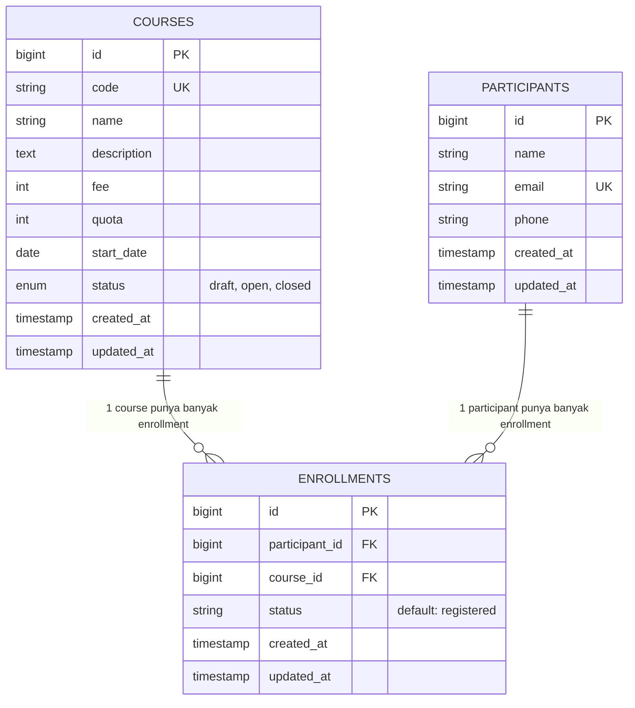

# ERD Final — Course, Participant, Enrollment

Sesuai Langkah 1 panduan Pertemuan 12. Buka file ini di editor yang
mendukung Mermaid (VS Code + ekstensi "Markdown Preview Mermaid
Support", GitHub, atau https://mermaid.live) untuk melihat diagramnya,
lalu screenshot hasilnya sebagai bukti.

## Elemen wajib (dicek dosen sesuai panduan §Langkah 1)

| Elemen | Keterangan di project ini |
|---|---|
| Primary Key | `id` pada ketiga tabel (bigint auto increment) |
| Foreign Key | `enrollments.participant_id -> participants.id`, `enrollments.course_id -> courses.id`, keduanya `cascadeOnDelete()` |
| Unique | `participants.email` (unique tunggal), `enrollments(participant_id, course_id)` (composite unique) |
| Cardinality | Course **1 → M** Enrollment; Participant **1 → M** Enrollment; secara konsep Course **M ↔ N** Participant lewat Enrollment |

## Jawaban checkpoint dosen (Langkah 1)

1. **Jika Alya ikut 3 kursus, berapa baris enrollment?**
   3 baris — satu baris per pasangan `(participant_id=Alya, course_id=...)`,
   bukan satu baris berisi 3 course sekaligus.
2. **Jika 20 peserta ikut Laravel Dasar, berapa baris enrollment untuk course itu?**
   20 baris — satu baris per peserta untuk `course_id` yang sama.
3. **Mengapa `course_name` tidak perlu disimpan lagi di `enrollments`?**
   Karena `enrollments.course_id` sudah menunjuk ke baris yang benar di
   `courses`; nama course cukup diambil lewat relasi (`$enrollment->course->name`)
   saat dibutuhkan. Menyimpan nama secara duplikat berisiko data tidak
   sinkron kalau nama course diubah lewat halaman edit (Pertemuan 11).
